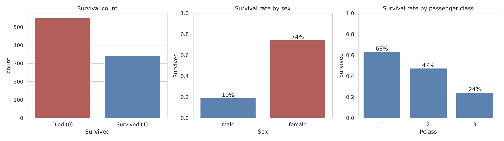
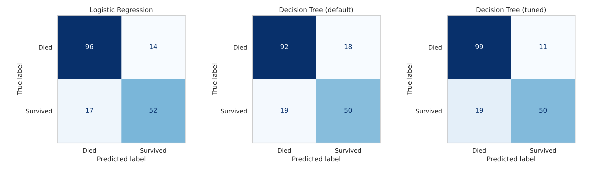
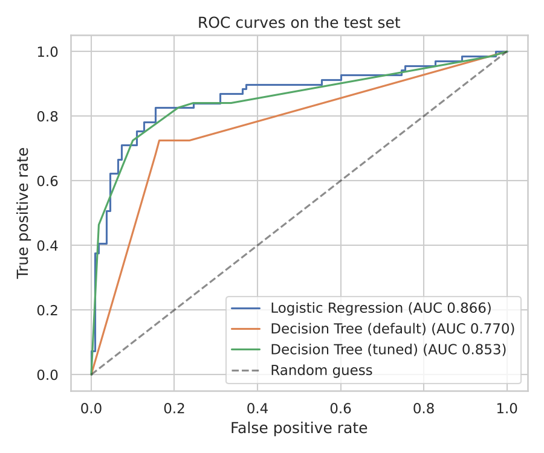
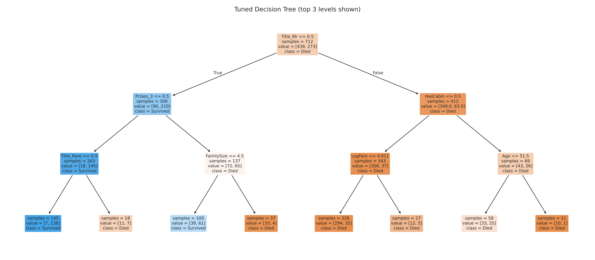

# Titanic Survival Prediction

A Python notebook that predicts which Titanic passengers survived, using Logistic Regression and a Decision Tree built with Scikit-learn. Built as Task 2 of the Month 2 project (predictive modelling) of a Data Science program, and written up in a 7-page PDF report.

The project follows the full path a small machine learning task needs: look at the data, clean it, split it properly, train more than one model, judge each one with the right metrics, and explain what the results actually mean. The aim was not the highest possible score. It was a model that is correct, honestly evaluated and easy to explain, with clear reasoning for every choice made along the way.

## Objective

Use the Titanic passenger data to build a basic predictive model that answers one question: **given what we know about a passenger, did they survive?** The target is the `Survived` column (1 = survived, 0 = died), so this is a binary classification problem.

The task brief asks for these steps, and the notebook covers each of them:
- Load and explore the dataset
- Handle missing values and encode categorical features
- Split the data into training and testing sets
- Train a predictive model and evaluate it with appropriate metrics
- Document the approach, the model performance and the conclusions

Two models are trained and compared: Logistic Regression as the main model, and a Decision Tree (untuned and tuned) to show overfitting and how to control it. Ensemble models such as Random Forest were left out on purpose, since the task asks for a simple model.

## Project structure

```
.
├── analysis/
│   └── Titanic_Survival_Prediction.ipynb   # main notebook (outputs included)
├── dataset/
│   └── Titanic-Dataset.csv                 # raw data
├── images/                                 # charts saved by the notebook
├── Titanic_Survival_Prediction_Report.pdf  # 7-page written report
└── README.md
```

## Dataset

`dataset/Titanic-Dataset.csv` holds 891 passengers and 12 columns (source: [Kaggle Titanic dataset](https://www.kaggle.com/datasets/yasserh/titanic-dataset)). 342 passengers survived (38.4%) and 549 did not.

| Group | Columns |
|---|---|
| Identity | PassengerId, Name, Ticket |
| Target | Survived (0 or 1) |
| Passenger profile | Pclass (1, 2, 3), Sex, Age |
| Family aboard | SibSp, Parch |
| Journey | Fare, Cabin, Embarked (C, Q, S) |

Three columns have missing values: Age (19.9%), Cabin (77.1%) and Embarked (2 rows). I also engineered four features: `Title` (from Name), `FamilySize`, `HasCabin` and `LogFare`.

## What the notebook covers

**Exploration and preprocessing**
- Missing value checks and survival rates by sex, class, age, fare and port
- Dropped `PassengerId` and `Ticket`, turned `Cabin` into a yes/no flag
- Median imputation for Age, most-frequent imputation for Embarked
- One-hot encoding for Pclass, Sex, Embarked and Title, standardised numbers for Logistic Regression
- A stratified 80/20 split (712 train, 179 test) done **before** imputation, with everything wrapped in Scikit-learn pipelines so nothing leaks from the test set

**Modelling and evaluation**
- A "always predict died" baseline to beat
- Logistic Regression, and a Decision Tree trained twice: default, then tuned with `GridSearchCV` (5-fold, training data only)
- Accuracy, precision, recall, F1, ROC-AUC, confusion matrices and ROC curves
- MSE and R2 on predicted probabilities, with a note on why they fit classification poorly
- 5-fold cross-validation on all 891 rows to check the test score is not a fluke
- Logistic Regression odds ratios, Decision Tree feature importance and the tree drawn out

## Model performance

| Model | Train accuracy | Test accuracy | Precision | Recall | F1 | ROC-AUC |
|---|---|---|---|---|---|---|
| Baseline (always "died") | - | 61.5% | - | - | - | 0.500 |
| Logistic Regression | 82.4% | **82.7%** | 0.788 | 0.754 | 0.770 | **0.866** |
| Decision Tree (default) | 98.7% | 79.3% | 0.735 | 0.725 | 0.730 | 0.770 |
| Decision Tree (tuned, depth 3) | 83.1% | **83.2%** | 0.820 | 0.725 | 0.769 | 0.853 |

5-fold cross-validation accuracy: Logistic Regression 82.5%, tuned Decision Tree 81.6%.

## Key findings

- Both tuned models reach about **83% test accuracy**, roughly 21 points above the 61.5% baseline.
- Sex is the strongest signal: women survived at **74.2%**, men at **18.9%**. Class matters too: 63.0% in first class against 24.2% in third.
- Together they are sharper still: **96.8%** of first class women survived, against **13.5%** of third class men.
- The untuned Decision Tree **overfits badly**: 98.7% on training data, 79.3% on test. Limiting depth to 3 removes the gap.
- The two final models are effectively tied: their test accuracy differs by **one passenger** out of 179. Logistic Regression is the preferred model because it has the better ROC-AUC, the better cross-validated mean and less variation between folds.
- Title, sex, class and family size drive almost every prediction, which fits the "women and children first" evacuation and unequal access to lifeboats.
- MSE and R2 are regression metrics. On probabilities they are about 0.13 and 0.44 for both final models, but accuracy, F1 and ROC-AUC are the metrics that matter here.

## Selected visuals






## Limitations

- Only 891 rows, so the test set has 179 passengers and its accuracy carries a margin of roughly 5 points. Small gaps between models are not meaningful.
- Age was filled with one global median. Grouping by title (a "Master" is a boy, a "Mr" is an adult) would be more accurate.
- Cabin was reduced to a yes/no flag, so deck location is lost. Ticket and surname groups were ignored, although families travelled and survived together.
- Sex and Title overlap heavily, so Logistic Regression coefficients share credit between them and the tree's importance for Sex shows as zero. Read them together, not one by one.
- The models show association, not cause, and say nothing about how a similar event would unfold today.
- Ensembles such as Random Forest or boosting would probably add a few points, but were skipped by design.

## How to run

```bash
git clone https://github.com/samarthgupta95/titanic-survival-prediction.git
cd titanic-survival-prediction/analysis
pip install numpy pandas matplotlib seaborn scikit-learn jupyter
jupyter notebook Titanic_Survival_Prediction.ipynb
```

Run the cells from top to bottom. The notebook reads the data from `dataset/` and writes the charts to `images/`. The random seed is fixed (42), so the numbers match this README and the report.

## Tech stack

Python 3, NumPy, Pandas, Matplotlib, Seaborn, Scikit-learn, Jupyter

## Author

Samarth Gupta ([GitHub](https://github.com/samarthgupta95))
